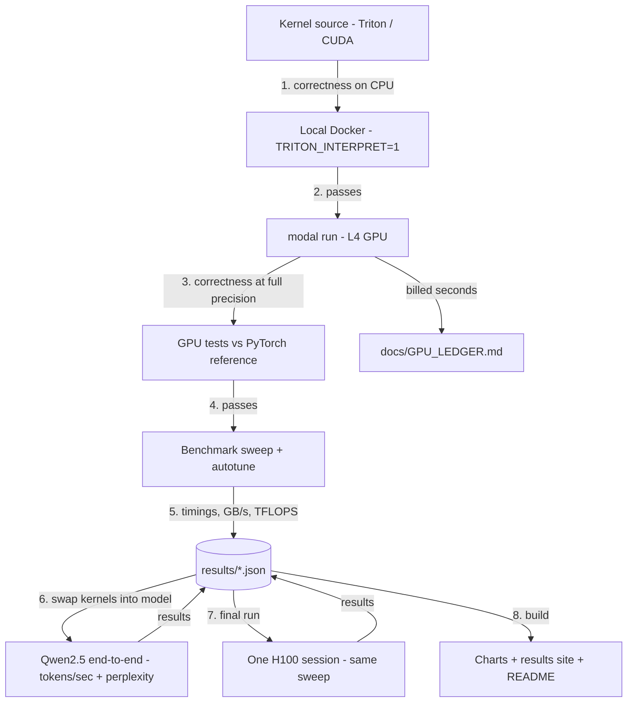

# LLM Decode Kernels: Project Plan

> **For Claude Code:** this plan runs under the `/autonomous-build` skill. The skill holds the general working rules (no mid-run questions, DECISIONS.md, PROGRESS.md, honest results, handoff). This file only adds what is specific to this project. **Where this plan and the skill disagree, this plan wins.** Section 1.1 (GPU budget) overrides everything else in this file.

---

## 0. Before you start (for Charlie, not Claude Code)

**Personal computer only**, never a work laptop.

1. **Modal account:** sign up at https://modal.com (Starter plan). Do **not** upgrade the plan.
2. **Spending limit:** in Modal's workspace settings, set a monthly spending limit of **$40** if the option is offered. This is your safety net on top of the plan's own caps.
3. **Connect Modal to this PC** (one time, it opens a browser to log in). In PowerShell:
   ```powershell
   python -m pip install modal
   python -m modal setup
   ```
   Then confirm with `python -m modal profile current`. Claude Code will also add Modal to the project's own environment; the login is shared.
4. **Docker Desktop running** (used for local CPU-only kernel tests, which cost nothing).
5. **No API key set** in the terminal:
   ```powershell
   Remove-Item Env:ANTHROPIC_API_KEY -ErrorAction SilentlyContinue
   ```
6. **Launch:** open `C:\dev\llm-decode-kernels` (this file inside) in VS Code. In the integrated terminal:
   ```powershell
   claude --dangerously-skip-permissions
   ```
   Then send: `/autonomous-build llm-decode-kernels-plan.md`
7. **At the end:** check `docs/GPU_LEDGER.md` against the Usage page in Modal's dashboard.

**If it stops** (usage limit, GPU budget reached, crash): send `/autonomous-build` again and it continues from `docs/PROGRESS.md`.

---

## 1. Project-specific rules (on top of the skill)

### 1.1 GPU budget guardrails (highest priority)
These rules exist so the project never costs more than planned. **When in doubt, don't run on a GPU.**

**Hard limits**

| Limit | Value |
|---|---|
| Total GPU time, whole project | **25 GPU-hours** |
| Total estimated spend, whole project | **$30** |
| Default GPU | **L4** only |
| H100 | **one** final benchmark session, max **1.5 hours**, only after all L4 results are final |
| Any other GPU type | **not allowed** |
| Max containers running at once | **1** (set `max_containers=1` on every function; never use `.map()` or `.spawn()` to fan out) |
| Reserved for the final runs (M6) | **$8** of the $30, never spent on development |

**Spend tracking**
- Keep `docs/GPU_LEDGER.md`: one row per GPU run with date, purpose, GPU type, billed seconds **including container startup**, estimated cost (GPU rate plus a 15% allowance for the CPU and memory Modal also bills), and running total. If Modal's CLI can report actual usage or billing, reconcile the ledger against it after each milestone.
- After every run, also check `modal app list` and stop anything still running with `modal app stop`.
- **Development budget is $22** ($30 minus the $8 reserve). When it runs out, stop development runs and go to M6 with whatever kernels are finished; unfinished ones are reported as such.
- If the reserve can't cover both final sessions, **drop the H100 session first** and keep the final L4 run.
- **At 100%:** stop all GPU work. Finish everything else (site, charts from existing results, README, handoff) and record what was skipped.
- Never upgrade the Modal plan, add a payment method, or change any account or billing setting.

**How Modal is used**
- **Only `modal run`** (runs once, then shuts down). **Never** `modal deploy`, `modal serve`, or anything that stays up.
- Every Modal function has a `timeout`: **10 minutes** by default, **30 minutes** max (benchmarks only).
- **Never use `modal run --detach`**, and never start a GPU run as a background job. A run must end with the command that started it, so if this Claude Code session stops (usage limit, crash), the GPU stops too.
- **First thing in every session, including after a restart:** run `modal app list` and stop any running app before doing anything else. Log it in the ledger if something was found.
- No warm containers: no `min_containers`, `keep_warm`, or long idle windows. Containers shut down as soon as the run ends.
- **Batch the work:** one container runs a whole test file or benchmark sweep, never one container per test.
- Cache model weights, datasets, and the Triton compile cache in a **Modal Volume**, so they aren't re-downloaded or recompiled on every run.
- **Download weights and datasets with a CPU-only Modal function**, never on a GPU container. GPU time is for kernels only.
- **Pin the GPU type** using the syntax in Modal's current docs, so a request is never silently upgraded to a pricier GPU. Every result records the GPU name reported by `nvidia-smi`.
- Never print, copy, or commit the Modal token (it lives in the user's home folder).

**Develop on CPU first (free)**
- Check kernel correctness **locally first** with Triton's interpreter mode (`TRITON_INTERPRET=1`), inside a local Linux Docker container on CPU. Only move to a GPU once a kernel passes there.
- **Compile the CUDA C++ kernel locally first** in a CUDA "devel" Docker image (`nvcc` compiles without a GPU), so compile errors never cost GPU time.
- Use small shapes for development runs. Full-size sweeps only in the benchmark milestones.

**Loop guard**
- If the same test fails on **3 GPU runs in a row**, stop using the GPU for that kernel. Debug it locally on CPU, log it in PROGRESS.md, and only return to the GPU with a concrete fix.
- If Modal returns a billing, quota, or spending-limit error: stop all GPU work immediately, record it, and continue with non-GPU work.

### 1.2 Checkpoints (power outage, crash, PC off)
Anything that cost GPU money must never be lost. On top of the skill's commit-per-milestone rule:
- **Right after every GPU run:** commit the results JSON and the updated `docs/GPU_LEDGER.md`, before doing anything else.
- **Each kernel step that passes** (CPU test passes, GPU test passes, benchmark done): commit.
- **Work in progress:** a `wip:` commit at least every 30 minutes of work, even if nothing passes yet. Never leave more than 30 minutes of work uncommitted.
- **Commits are local and frequent; pushes are occasional.** Push to the private GitHub repo at the end of every milestone, and otherwise at least every **2 hours** if there are unpushed commits. If a push fails, keep committing locally and retry at the next push point.
- **Resumable GPU runs:** benchmark sweeps save each finished shape to the Modal Volume as they go, and a rerun skips shapes already measured. A run cut off halfway only redoes the unfinished part.
- **Update `docs/PROGRESS.md` before every commit** with the exact next step, so a restart picks up in the right place.
- **On restart after a crash:** run `git status`. Commit any half-finished changes as `wip: recovered after interruption` before continuing (never discard them), then do the Modal cleanup check from Section 1.1.

### 1.3 Honest benchmarking
- Fix the benchmark method (warmup, iterations, timing with CUDA events or `triton.testing.do_bench`, shapes) **before** looking at results, and log it in DECISIONS.md.
- Always compare against strong baselines, not just naive code (Section 3).
- Report losses as clearly as wins. If a kernel is slower than `torch.compile`, say so and explain why.
- Look up each GPU's peak memory bandwidth and compute numbers from NVIDIA's official spec sheets; don't use memory.
- Charts state which GPU, data type, and shapes they cover.
- Cloud GPUs vary run to run: report the **median of at least 3 repeated sweeps** with min/max, and flag any result whose spread is over 10%.

---

## 2. Goal

**Write custom GPU kernels for the slowest parts of LLM decoding, prove them correct, measure them against the hardware's limits, and show the gain inside a real model.**

Skills it shows:
- **GPU programming:** Triton kernels, tiling, memory coalescing, autotuning, plus one CUDA C++ kernel (the 4-bit decode matmul)
- **Performance engineering:** roofline analysis, % of peak bandwidth, profiling
- **LLM inference:** kernel fusion, 4-bit weight quantization, decode vs prefill behavior
- **MLOps discipline:** reproducible benchmarks, a cost-capped cloud GPU workflow

**The project should look great.** Charts and diagrams feed the website, slides, and video. Small scope, polished finish.

---

## 3. Scope

### In scope
1. **Kernel 1, fused RMSNorm (+ residual add):** memory-bound warm-up. Reports GB/s and % of peak bandwidth.
2. **Kernel 2, fused SwiGLU:** `silu(gate) * up` in one pass.
3. **Kernel 3, W4A16 matmul (the headline):** int4 weights packed 8 per int32, fp16 activations, group-wise scales (group size 128), dequantized inside the kernel. Covers decode shapes (batch 1 to 16) and prefill shapes (up to 2048 tokens), with autotuning and a split-K path for decode.
4. **CUDA C++ version** of the W4A16 decode kernel, built with `torch.utils.cpp_extension`, compared to the Triton one.
5. **Baselines:** PyTorch eager (cuBLAS fp16), `torch.compile`, naive "dequantize then matmul", and one established 4-bit kernel: try **torchao's int4 weight-only** path first, then another maintained library if that fails (log which).
6. **End-to-end:** swap the kernels into **Qwen2.5-1.5B-Instruct**, with simple round-to-nearest 4-bit quantization. Measure decode tokens/sec (batch 1) and prefill throughput, fp16 vs our kernels.
   - At batch 1, Python and kernel-launch overhead can hide kernel gains. Use the same setup for both sides (static KV cache plus CUDA graphs or `torch.compile`, whichever works with the custom kernels; log it), and also report time spent in the swapped layers alone.
   - Keep the embeddings and `lm_head` in fp16, and say so.
7. **Quality check:** perplexity on a small WikiText-2 slice and greedy outputs on a few prompts, fp16 vs 4-bit. A small quality drop is expected and is about the quantization method, not the kernel; say so.
8. **Results site, charts, and portfolio kit.**

### Out of scope
- Training kernels, attention / paged-attention kernels, better quantization methods (AWQ, GPTQ), multi-GPU, AMD or Apple GPUs, a hosted demo.

---

## 4. Architecture



Every result file records GPU type, driver and CUDA version, Triton and PyTorch versions, dtype, shapes, and timing method.

---

## 5. Stack

| Piece | Choice |
|---|---|
| Kernels | Triton (latest stable), CUDA C++ via `torch.utils.cpp_extension` |
| Framework | PyTorch (CUDA build), Hugging Face Transformers |
| GPU cloud | Modal (`modal run` only), L4 default, one H100 session |
| Local CPU tests | Docker (Linux image) with `TRITON_INTERPRET=1` |
| Profiling | Nsight Compute if Modal allows it; otherwise Triton's Proton profiler or the PyTorch profiler (log which) |
| Charts | matplotlib (PNG/SVG) + Plotly (interactive) |
| Site | static HTML + vanilla JS + Tailwind via CDN, no build step |
| Screenshots / GIF | Playwright |
| Quality | ruff, pytest, GitHub Actions (CPU tests only in CI, never GPU) |

---

## 6. Visual design rules

Same base look as Bulwark and reachability-triage, with its own accent.

- **Dark theme.** Background `#0B0F17`, panels `#131A26`, borders `#1F2937`, text `#E5E7EB`, muted `#9CA3AF`.
- **Accent:** lime `#A3E635`.
- **Series colors:** our Triton kernel `#A3E635`, our CUDA kernel `#38BDF8`, `torch.compile` `#A78BFA`, PyTorch eager `#9CA3AF`, library baseline `#F59E0B`.
- **Fonts:** Inter for UI, JetBrains Mono for code and numbers.
- **Charts** (PNG 1600px + SVG in `assets/charts/`, title states the takeaway):
  - speedup vs PyTorch across sizes, per kernel
  - roofline chart (log-log) with each kernel as a point against the GPU's bandwidth and compute ceilings
  - % of peak memory bandwidth per kernel
  - decode tokens/sec, fp16 vs our kernels, L4 and H100
  - Triton vs CUDA comparison for the decode matmul
- **Explainer animation:** an SVG/HTML animation of how the W4A16 kernel tiles its work (load packed int4 tile → unpack → scale → multiply-accumulate), exported as a GIF.
- **Results site:** overview with big stat cards, one page per kernel (what it does, a short code excerpt, its charts, its roofline point, profiling notes), and the end-to-end page.

---

## 7. Milestones

### M0: Setup
1. Skill environment checks, plus: `modal profile current` works, Docker is running, no `ANTHROPIC_API_KEY` set. If Modal isn't connected, do everything possible on CPU and put "run `modal setup`" first in the questions file.
2. Create the **private** repo (name in Section 8), rename this file to `PLAN.md`, set up `docs/` and `docs/GPU_LEDGER.md`. Add `.gitattributes` with `* text=auto eol=lf` (files are mounted into Linux containers).
3. Build the local CPU test container and the Modal image (CUDA devel base so `nvcc` is available, PyTorch, Triton, Transformers).
4. Download the model and dataset into the Modal Volume with a CPU-only function.
5. One tiny smoke test on an L4 (vector add) to confirm the whole loop and ledger work. Target: under 2 minutes of GPU time. Record the actual billed time, including startup, to calibrate later estimates.

**Done when:** a kernel can go from local CPU test to L4 test in one command each, and the ledger records the smoke test.

### M1: Benchmark harness
- One harness for all kernels: correctness check (`torch.testing.assert_close` with logged tolerances, random and odd shapes), timing, GB/s and TFLOPS math, JSON output.
- Benchmark method frozen and logged (Section 1.3).

**Done when:** the harness runs a baseline-only sweep on L4 and writes results JSON.

### M2: Fused RMSNorm and SwiGLU
- Both kernels, CPU-tested, then GPU-tested and benchmarked against eager and `torch.compile`.

**Done when:** both are correct and have benchmark results with % of peak bandwidth.

### M3: W4A16 matmul (Triton)
- Packing format, quantize/dequantize reference in PyTorch, the Triton kernel, autotune configs, split-K for decode.
- Benchmark against all baselines across decode and prefill shapes.

**Done when:** correct across shapes, with results for every baseline.

### M4: CUDA C++ decode kernel
- CUDA version of the decode (batch 1 to 16) case only. Compared to the Triton version: speed and lines of code, plus a short "when each is worth it" note.

**Done when:** correct, benchmarked, and the comparison note is written.

### M5: End-to-end in a real model
- Swap our kernels into the model's RMSNorm, MLP activation, and linear layers.
- Decode tokens/sec (batch 1) and prefill throughput, fp16 vs ours. Perplexity and greedy-output comparison.

**Done when:** end-to-end numbers and the quality check are in results JSON.

### M6: Final benchmarks
- Rerun all final sweeps on L4, then the **single H100 session** (Section 1.1), with every kernel's final config.

**Done when:** final results exist for both GPUs, and the ledger total is under the caps.

### M7: Site, assets, and portfolio kit
- Results site per Section 6 in `site/`; GitHub Pages workflow prepared but **not enabled** (repo is private).
- One command (e.g. `python -m kernels.assets`) regenerates every chart and the site from results JSON, with no GPU.
- Explainer animation and GIF.
- `docs/DEMO_SCRIPT.md` (2 minutes), `docs/SLIDES_OUTLINE.md` (6 to 8 slides), `docs/PORTFOLIO_CARD.md` (pitch, headline metric, 3 bullets, tags, CV bullet).

**Done when:** assets regenerate cleanly from results, and everything matches Section 6.

### M8: README and handoff
- README: pitch, hero chart, roofline chart, results table, how it works, "run it yourself on Modal" quickstart with expected cost, limitations.
- Handoff per the skill, plus: final GPU-hours and estimated spend from the ledger, and whether any cap was hit.

---

## 8. Repo name, description, and topics

**Name:** `llm-decode-kernels`

**Description (GitHub "About"):**
> Triton and CUDA kernels for LLM decoding: fused RMSNorm, fused SwiGLU, and a 4-bit weight matmul. Benchmarked against PyTorch on L4 and H100, with roofline analysis and end-to-end tokens/sec on Qwen2.5.

**Topics:**
`triton` `cuda` `gpu-kernels` `gpu-programming` `llm-inference` `quantization` `int4` `gemm` `kernel-fusion` `roofline` `pytorch` `performance-engineering` `benchmarking` `qwen` `modal`

---

## 9. Metrics to report

| Metric | What it shows |
|---|---|
| Speedup vs eager, `torch.compile`, library baseline | whether the kernel is worth it |
| Achieved GB/s and % of peak bandwidth | how close to the hardware limit |
| Roofline position | memory-bound vs compute-bound, and the headroom left |
| Decode tokens/sec, batch 1, fp16 vs ours | real-model impact |
| Weight memory, fp16 vs 4-bit | why 4-bit matters |
| Perplexity delta | quality cost of the quantization |
| Triton vs CUDA (speed, lines of code) | engineering trade-off |
| Total GPU-hours and dollars | the whole project's cost |

Headline format: **"4-bit decode matmul reaches X% of peak memory bandwidth on L4, for Y× faster decoding than fp16 on Qwen2.5."**

---

## 10. Stretch (only after M8, and only within the GPU budget)

1. Fuse the residual add into the next kernel's input.
2. A second model size in the end-to-end test.
3. An FP8 variant of the matmul (L4 and H100 support it).

---

## 11. Boundaries

- Personal project, personal machine, public models and data only.
- Nothing from Charlie's employer.
