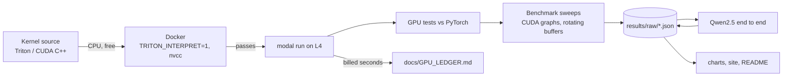

# llm-decode-kernels

Triton and CUDA kernels for the slow parts of LLM decoding: fused RMSNorm, fused SwiGLU, and a
4-bit weight matmul. Each one is tested against PyTorch, measured against the GPU's limits, and
swapped into Qwen2.5-1.5B.

<!-- gen:headline -->
**4-bit decode matmul reaches 81% of peak memory bandwidth on L4, for 1.82x faster decoding than fp16 on Qwen2.5-1.5B.**
<!-- /gen:headline -->


## Results


### End to end, Qwen2.5-1.5B-Instruct

<!-- gen:e2e -->
| GPU | Backend | Decode tok/s (batch 1) | Swapped layers, ms/token | Prefill tok/s (T=2048) | WikiText-2 ppl | Linear weights |
|---|---|---|---|---|---|---|
| L4 | fp16 | 57.9 | 11.47 | 11886 | 10.654 | 2.62 GB |
| L4 | ours | 105.5 | 3.94 | 11592 | 11.900 | 0.70 GB |
| L4 | ours_cuda | 109.0 | 3.72 | 11751 | 11.900 | 0.70 GB |
| L4 | w4_ref | - | - | - | 11.901 | 0.70 GB |
<!-- /gen:e2e -->

### 4-bit matmul (W4A16)

<!-- gen:w4a16 -->
| Layer (N x K) | M | GPU | Triton (us) | CUDA (us) | fp16 cuBLAS (us) | torchao (us) | torch.compile (us) | Triton vs fp16 | Triton % peak BW |
|---|---|---|---|---|---|---|---|---|---|
| qwen_gate_up (17920x1536) | 1 | L4 | 60.4 | 67.3 | 209.3 | 79.2 | 83.1 | 3.47x | 81% |
| qwen_gate_up (17920x1536) | 16 | L4 | 85.9 | 168.3 | 218.4 | 144.9 | 446.6 | 2.54x | 59% |
| qwen_gate_up (17920x1536) | 2048 | L4 | 2572.1 | - | 2117.1 | 14494.4 | 2416.1 | 0.82x | 12% |
| qwen_down (1536x8960) | 1 | L4 | 34.2 | 37.9 | 104.2 | 34.2 | 45.9 | 3.05x | 72% |
| qwen_down (1536x8960) | 16 | L4 | 44.3 | 99.3 | 115.1 | 84.9 | 170.6 | 2.60x | 58% |
| qwen_down (1536x8960) | 2048 | L4 | 1344.9 | - | 1282.4 | 8153.3 | 1478.8 | 0.95x | 12% |
| 8b_up (14336x4096) | 1 | L4 | 161.6 | 133.0 | 430.7 | 123.7 | 148.2 | 2.67x | 64% |
| 8b_up (14336x4096) | 16 | L4 | 172.1 | 343.7 | 481.3 | 296.1 | 1156.5 | 2.80x | 62% |
| 8b_up (14336x4096) | 2048 | L4 | 5184.9 | - | 4574.0 | 28792.3 | 5305.3 | 0.88x | 7% |
<!-- /gen:w4a16 -->

### Fused RMSNorm and SwiGLU

<!-- gen:kernels -->
| Kernel | Shape | GPU | Ours (us) | PyTorch eager (us) | torch.compile (us) | Speedup vs eager | % peak BW |
|---|---|---|---|---|---|---|---|
| RMSNorm + residual | N=4096, M=16384 | L4 | 2282.5 | 12019.0 | 2209.5 | 5.27x | 78% |
| RMSNorm + residual | N=1536, M=1 | L4 | 1.3 | 10.3 | 1.3 | 7.79x | 4% |
| SwiGLU | I=8960, M=4096 | L4 | 933.0 | 1561.5 | 941.1 | 1.67x | 79% |
| SwiGLU | I=8960, M=1 | L4 | 1.1 | 2.7 | 1.0 | 2.43x | 16% |
<!-- /gen:kernels -->

Times are CUDA-graph medians of 3 sweeps, with enough rotating input copies that every call reads
from DRAM (working set at least 4x the L2 cache).
<!-- gen:spread -->
Median spread between the 3 sweeps: 0.8%. 9 of 375 measurements spread more than 10% (marked in the site tables).
<!-- /gen:spread -->

### Cost

<!-- gen:cost -->
Total GPU time: **1.18 GPU-hours**, estimated **$1.09** (cap $30), of which H100: 0 min. Every run is in [docs/GPU_LEDGER.md](docs/GPU_LEDGER.md).
<!-- /gen:cost -->

## Quickstart

```bash
pip install -e ".[local]" && python -m modal setup   # once
docker compose run --rm cpu                          # all kernel tests on CPU, free
python -m kernels.gpu pytest                         # same tests on an L4 (about $0.05)
```

Rebuild every chart, the site and this README's tables from the saved results (no GPU):
`python -m kernels.assets`.

## How it works



- **Fused RMSNorm + residual** ([kernels/rmsnorm.py](kernels/rmsnorm.py)): one program per row,
  adds the residual, writes the new residual stream and the normalized output in one pass.
- **Fused SwiGLU** ([kernels/swiglu.py](kernels/swiglu.py)): reads both halves of the merged
  gate/up output in place and writes `silu(gate) * up`.
- **W4A16 matmul** ([kernels/w4a16.py](kernels/w4a16.py)): int4 weights packed 8 per int32,
  fp16 scale and zero per group of 128, unpacked and dequantized in registers, then `tl.dot` on
  tensor cores. Autotuned. Decode shapes (batch 1 to 16) can split K across programs so a small
  matmul still fills the GPU.
- **CUDA C++ decode kernel** ([kernels/cuda/w4a16_decode.cu](kernels/cuda/w4a16_decode.cu)): the
  same math as a hand-written GEMV with 16-byte loads, shared-memory reduction and split-K.
- **End to end** ([kernels/e2e/model.py](kernels/e2e/model.py)): a small Qwen2 runner on the
  Hugging Face weights with a static KV cache, captured in a CUDA graph. fp16 and 4-bit use the
  same runner, so the difference is the kernels.

Benchmark method and every judgment call: [docs/DECISIONS.md](docs/DECISIONS.md).

## Limitations

- Quantization is plain round-to-nearest. AWQ or GPTQ would lose less quality; that was out of
  scope. The perplexity change belongs to the quantization method, not the kernels.
- Embeddings, `lm_head`, attention and RoPE stay fp16. On a 1.5B model the fp16 `lm_head` is a
  large share of the bytes read per token, which caps the end-to-end speedup.
- Batch 1 decode only for the end-to-end numbers. The CUDA kernel covers decode (M up to 16) only.
- Cloud GPUs vary from run to run. We report the median of 3 sweeps in one container per GPU,
  not across many machines.
- The torchao baseline runs in bf16 because its int4 kernel (tinygemm) only supports bf16.
- Two GPU types (L4, H100). No AMD, Apple, or multi-GPU.
