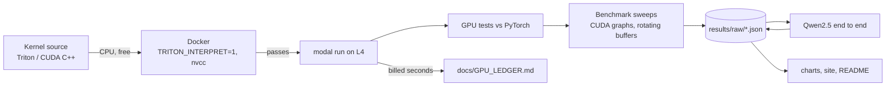

# llm-decode-kernels

Triton and CUDA kernels for the slow parts of LLM decoding: fused RMSNorm, fused SwiGLU, and a
4-bit weight matmul. Each one is tested against PyTorch, measured against the GPU's limits, and
swapped into Qwen2.5-1.5B.

<!-- gen:headline -->
**4-bit decode matmul reaches 82% of peak memory bandwidth on L4, for 1.99x faster decoding than fp16 on Qwen2.5-1.5B.**
<!-- /gen:headline -->


## Results


### End to end, Qwen2.5-1.5B-Instruct

<!-- gen:e2e -->
| GPU | Backend | Decode tok/s (batch 1) | Swapped layers, ms/token | Prefill tok/s (T=2048) | WikiText-2 ppl | Linear weights |
|---|---|---|---|---|---|---|
| H100 | fp16 | 283.1 | 2.32 | 108242 | 10.654 | 2.62 GB |
| H100 | ours | 397.9 | 1.31 | 79706 | 11.900 | 0.70 GB |
| H100 | ours_cuda | 338.6 | 1.74 | 79961 | 11.900 | 0.70 GB |
| H100 | w4_ref | - | - | - | 11.901 | 0.70 GB |
| L4 | fp16 | 59.5 | 11.36 | 12409 | 10.654 | 2.62 GB |
| L4 | ours | 118.2 | 3.28 | 12346 | 11.900 | 0.70 GB |
| L4 | ours_cuda | 114.4 | 3.62 | 12262 | 11.900 | 0.70 GB |
| L4 | w4_ref | - | - | - | 11.901 | 0.70 GB |
<!-- /gen:e2e -->

### 4-bit matmul (W4A16)

<!-- gen:w4a16 -->
| Layer (N x K) | M | GPU | Triton (us) | CUDA (us) | fp16 cuBLAS (us) | torchao (us) | torch.compile (us) | Triton vs fp16 | Triton % peak BW |
|---|---|---|---|---|---|---|---|---|---|
| qwen_gate_up (17920x1536) | 1 | L4 | 59.9 | 65.7 | 207.8 | 78.5 | 82.6 | 3.47x | 82% |
| qwen_gate_up (17920x1536) | 16 | L4 | 79.2 | 164.9 | 226.5 | 141.5 | 443.3 | 2.86x | 64% |
| qwen_gate_up (17920x1536) | 2048 | L4 | 2485.1 | - | 2083.7 | 14076.1 | 2372.4 | 0.84x | 13% |
| qwen_down (1536x8960) | 1 | L4 | 33.6 | 37.6 | 102.8 | 34.1 | 44.3 | 3.06x | 73% |
| qwen_down (1536x8960) | 16 | L4 | 42.1 | 95.7 | 111.2 | 81.9 | 167.4 | 2.64x | 61% |
| qwen_down (1536x8960) | 2048 | L4 | 1320.1 | - | 1284.1 | 7906.2 | 1435.3 | 0.97x | 13% |
| 8b_up (14336x4096) | 1 | L4 | 123.9 | 131.7 | 429.9 | 123.3 | 144.2 | 3.47x | 84% |
| 8b_up (14336x4096) | 16 | L4 | 160.9 | 313.9 | 464.4 | 282.4 | 1152.5 | 2.89x | 66% |
| 8b_up (14336x4096) | 2048 | L4 | 5025.5 | - | 4472.1 | 28082.2 | 5152.9 | 0.89x | 7% |
| qwen_gate_up (17920x1536) | 1 | H100 | 12.7 | 18.6 | 23.0 | 16.3 | 21.2 | 1.80x | 34% |
| qwen_gate_up (17920x1536) | 16 | H100 | 20.4 | 75.8 | 23.8 | 46.6 | 61.7 | 1.16x | 22% |
| qwen_gate_up (17920x1536) | 2048 | H100 | 345.8 | - | 177.0 | 5034.3 | 219.6 | 0.51x | 8% |
| qwen_down (1536x8960) | 1 | H100 | 14.7 | 21.4 | 14.4 | 12.4 | 10.8 | 0.98x | 15% |
| qwen_down (1536x8960) | 16 | H100 | 14.8 | 54.1 | 14.9 | 28.0 | 43.6 | 1.00x | 15% |
| qwen_down (1536x8960) | 2048 | H100 | 232.9 | - | 83.0 | 2002.5 | 116.6 | 0.36x | 6% |
| 8b_up (14336x4096) | 1 | H100 | 20.8 | 30.4 | 42.4 | 20.3 | 33.5 | 2.04x | 45% |
| 8b_up (14336x4096) | 16 | H100 | 33.0 | 135.9 | 43.0 | 69.7 | 126.1 | 1.31x | 29% |
| 8b_up (14336x4096) | 2048 | H100 | 743.7 | - | 346.5 | 7909.4 | 436.5 | 0.47x | 4% |
<!-- /gen:w4a16 -->

### Fused RMSNorm and SwiGLU

<!-- gen:kernels -->
| Kernel | Shape | GPU | Ours (us) | PyTorch eager (us) | torch.compile (us) | Speedup vs eager | % peak BW |
|---|---|---|---|---|---|---|---|
| RMSNorm + residual | N=4096, M=16384 | L4 | 2277.1 | 12021.2 | 2212.1 | 5.28x | 79% |
| RMSNorm + residual | N=1536, M=1 | L4 | 1.3 | 10.2 | 1.3 | 7.80x | 4% |
| SwiGLU | I=8960, M=4096 | L4 | 932.4 | 1559.0 | 879.3 | 1.67x | 79% |
| SwiGLU | I=8960, M=1 | L4 | 1.1 | 2.7 | 1.0 | 2.46x | 16% |
| RMSNorm + residual | N=4096, M=16384 | H100 | 180.5 | 1075.6 | 183.2 | 5.96x | 89% |
| RMSNorm + residual | N=1536, M=1 | H100 | 1.5 | 12.7 | 1.4 | 8.69x | 0% |
| SwiGLU | I=8960, M=4096 | H100 | 77.5 | 209.6 | 74.7 | 2.70x | 85% |
| SwiGLU | I=8960, M=1 | H100 | 1.5 | 3.7 | 1.3 | 2.43x | 1% |
<!-- /gen:kernels -->

Times are CUDA-graph medians of 3 sweeps, with enough rotating input copies that every call reads
from DRAM (working set at least 4x the L2 cache).
<!-- gen:spread -->
Median spread between the 3 sweeps: 0.3%. 2 of 748 measurements spread more than 10% (marked in the site tables).
<!-- /gen:spread -->

### Cost

<!-- gen:cost -->
Total GPU time: **2.64 GPU-hours**, estimated **$5.46** (cap $30), of which H100: 50 min. Every run is in [docs/GPU_LEDGER.md](docs/GPU_LEDGER.md).
<!-- /gen:cost -->

## Quickstart

```bash
pip install -e ".[local]" && python -m modal setup   # once
docker compose run --rm cpu                          # all kernel tests on CPU, free
python -m kernels.gpu pytest                         # same tests on an L4 (about $0.05)
```

Rebuild every chart, the site and this README's tables from the saved results (no GPU):
`python -m kernels.assets`.

## How it works



- **Fused RMSNorm + residual** ([kernels/rmsnorm.py](kernels/rmsnorm.py)): one program per row,
  adds the residual, writes the new residual stream and the normalized output in one pass.
- **Fused SwiGLU** ([kernels/swiglu.py](kernels/swiglu.py)): reads both halves of the merged
  gate/up output in place and writes `silu(gate) * up`.
- **W4A16 matmul** ([kernels/w4a16.py](kernels/w4a16.py)): int4 weights packed 8 per int32,
  fp16 scale and zero per group of 128, unpacked and dequantized in registers, then `tl.dot` on
  tensor cores. Autotuned. Decode shapes (batch 1 to 16) can split K across programs so a small
  matmul still fills the GPU.
- **CUDA C++ decode kernel** ([kernels/cuda/w4a16_decode.cu](kernels/cuda/w4a16_decode.cu)): the
  same math as a hand-written GEMV with 16-byte loads, shared-memory reduction and split-K.
- **End to end** ([kernels/e2e/model.py](kernels/e2e/model.py)): a small Qwen2 runner on the
  Hugging Face weights with a static KV cache, captured in a CUDA graph. fp16 and 4-bit use the
  same runner, so the difference is the kernels.

Benchmark method and every judgment call: [docs/DECISIONS.md](docs/DECISIONS.md).

## Limitations

- Quantization is plain round-to-nearest. AWQ or GPTQ would lose less quality; that was out of
  scope. The perplexity change belongs to the quantization method, not the kernels.
- Embeddings, `lm_head`, attention and RoPE stay fp16. On a 1.5B model the fp16 `lm_head` is a
  large share of the bytes read per token, which caps the end-to-end speedup.
- Batch 1 decode only for the end-to-end numbers. The CUDA kernel covers decode (M up to 16) only.
- Cloud GPUs vary from run to run. We report the median of 3 sweeps in one container per GPU,
  not across many machines.
- The torchao baseline runs in bf16 because its int4 kernel (tinygemm) only supports bf16.
- Two GPU types (L4, H100). No AMD, Apple, or multi-GPU.
