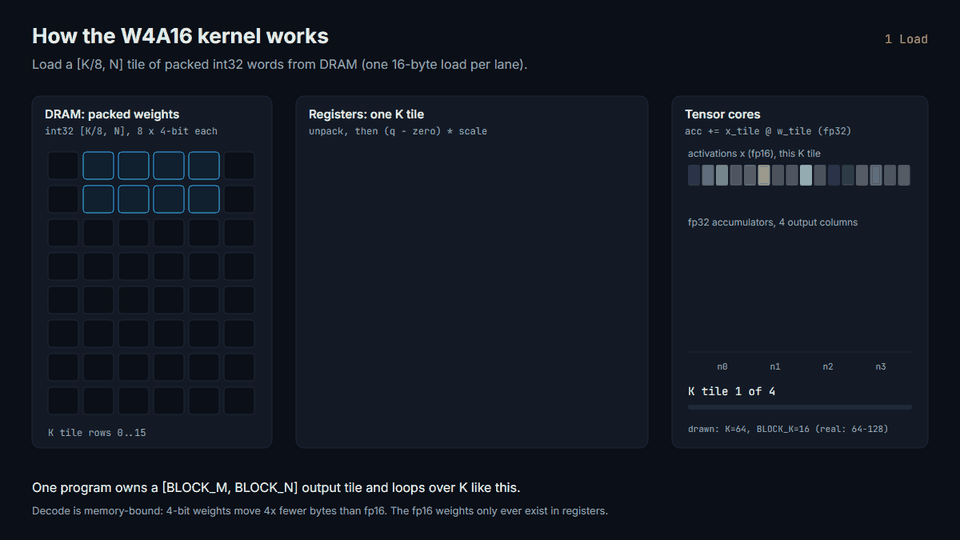
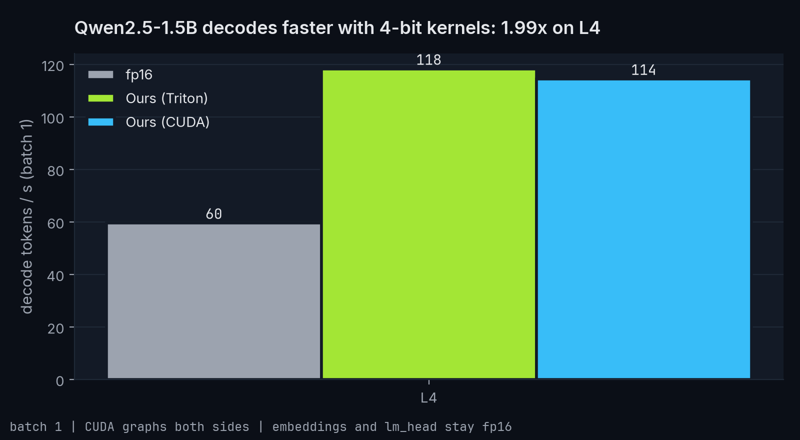
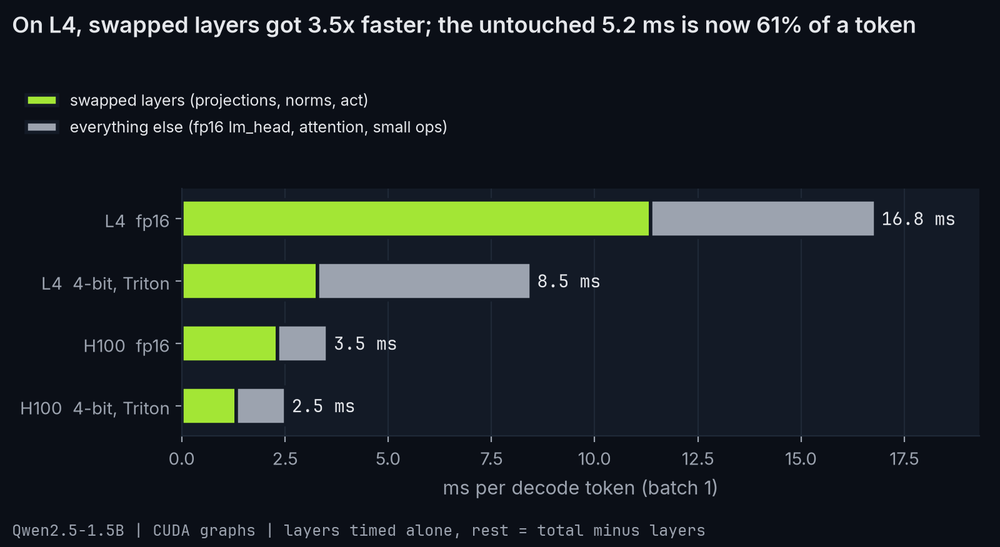
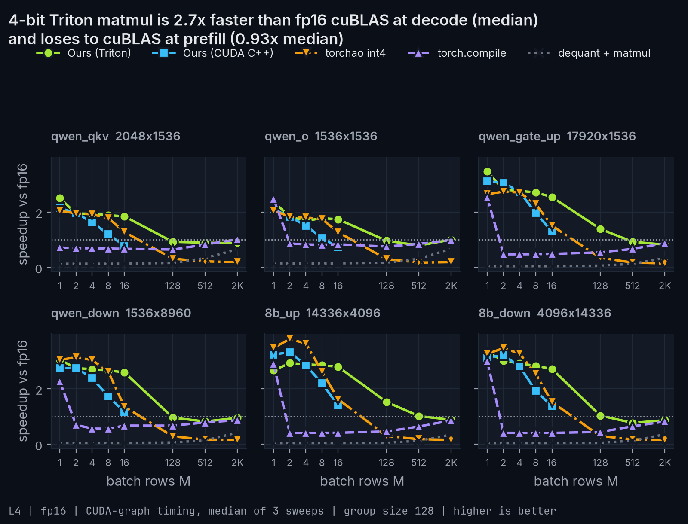
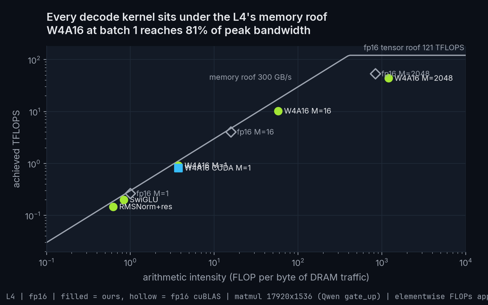
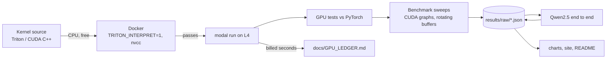

# llm-decode-kernels

Triton and CUDA kernels for the slow parts of LLM decoding: fused RMSNorm, fused SwiGLU, and a
4-bit weight matmul. Each one is tested against PyTorch, measured against the GPU's limits, and
swapped into Qwen2.5-1.5B.

<!-- gen:headline -->
**4-bit decode matmul reaches 82% of peak memory bandwidth on L4, for 1.99x faster decoding than fp16 on Qwen2.5-1.5B.**
<!-- /gen:headline -->



## Results in short

- **Qwen2.5-1.5B decodes 1.99x faster on an L4 and 1.41x faster on an H100** (batch 1, both
  sides under CUDA graphs). The swapped layers got 3.5x faster on the L4; the parts we did not
  touch (fp16 `lm_head`, attention, small ops) are now most of each token.
- **The 4-bit matmul reaches 82-84% of the L4's peak memory bandwidth at batch 1**, above a plain
  device-to-device copy (77%). It is 2.8x faster than fp16 cuBLAS at decode sizes (median).
- **On the H100 it reaches only 34-45%.** The H100 has about 11x the L4's bandwidth but far less
  extra arithmetic per byte, so unpacking the 4-bit weights becomes the limit. It still beats
  fp16 cuBLAS on large layers (1.8-2.0x) but loses on the two small Qwen attention layers.
- **At prefill sizes cuBLAS wins**: 0.96x of fp16 on the L4 and 0.41x on the H100 (median). The
  kernel is built for decode.
- **Fused RMSNorm and SwiGLU reach 79-89% of peak** on both GPUs, up to 8x faster than PyTorch
  eager, and on par with `torch.compile`, which generates an equally good fused kernel.
- **Quality**: WikiText-2 perplexity goes from 10.654 to 11.900. A dequantize-then-cuBLAS
  reference with the same 4-bit weights gives 11.901, so the cost comes from round-to-nearest
  quantization, not from the kernels.
- **Triton vs CUDA C++**: the Triton kernel ended up faster at every shape (77% vs 70% of peak at
  batch 1 on the L4, 62% vs 29% at batch 16). Details in
  [docs/TRITON_VS_CUDA.md](docs/TRITON_VS_CUDA.md).









More charts, per-kernel pages, profiler output and the H100 results are on the results site
(`site/index.html`, open it locally).

### End to end, Qwen2.5-1.5B-Instruct

<!-- gen:e2e -->
| GPU | Backend | Decode tok/s (batch 1) | Swapped layers, ms/token | Prefill tok/s (T=2048) | WikiText-2 ppl | Linear weights |
|---|---|---|---|---|---|---|
| L4 | fp16 | 59.5 | 11.36 | 12409 | 10.654 | 2.62 GB |
| L4 | ours | 118.2 | 3.28 | 12346 | 11.900 | 0.70 GB |
| L4 | ours_cuda | 114.4 | 3.62 | 12262 | 11.900 | 0.70 GB |
| L4 | w4_ref | - | - | - | 11.901 | 0.70 GB |
| H100 | fp16 | 283.1 | 2.32 | 108242 | 10.654 | 2.62 GB |
| H100 | ours | 397.9 | 1.31 | 79706 | 11.900 | 0.70 GB |
| H100 | ours_cuda | 338.6 | 1.74 | 79961 | 11.900 | 0.70 GB |
| H100 | w4_ref | - | - | - | 11.901 | 0.70 GB |
<!-- /gen:e2e -->

### 4-bit matmul (W4A16)

<!-- gen:w4a16 -->
| Layer (N x K) | M | GPU | Triton (us) | CUDA (us) | fp16 cuBLAS (us) | torchao (us) | torch.compile (us) | Triton vs fp16 | Triton % peak BW |
|---|---|---|---|---|---|---|---|---|---|
| qwen_gate_up (17920x1536) | 1 | L4 | 59.9 | 65.7 | 207.8 | 78.5 | 82.6 | 3.47x | 82% |
| qwen_gate_up (17920x1536) | 16 | L4 | 79.2 | 164.9 | 226.5 | 141.5 | 443.3 | 2.86x | 64% |
| qwen_gate_up (17920x1536) | 2048 | L4 | 2485.1 | - | 2083.7 | 14076.1 | 2372.4 | 0.84x | 13% |
| qwen_down (1536x8960) | 1 | L4 | 33.6 | 37.6 | 102.8 | 34.1 | 44.3 | 3.06x | 73% |
| qwen_down (1536x8960) | 16 | L4 | 42.1 | 95.7 | 111.2 | 81.9 | 167.4 | 2.64x | 61% |
| qwen_down (1536x8960) | 2048 | L4 | 1320.1 | - | 1284.1 | 7906.2 | 1435.3 | 0.97x | 13% |
| 8b_up (14336x4096) | 1 | L4 | 123.9 | 131.7 | 429.9 | 123.3 | 144.2 | 3.47x | 84% |
| 8b_up (14336x4096) | 16 | L4 | 160.9 | 313.9 | 464.4 | 282.4 | 1152.5 | 2.89x | 66% |
| 8b_up (14336x4096) | 2048 | L4 | 5025.5 | - | 4472.1 | 28082.2 | 5152.9 | 0.89x | 7% |
| qwen_gate_up (17920x1536) | 1 | H100 | 12.7 | 18.6 | 23.0 | 16.3 | 21.2 | 1.80x | 34% |
| qwen_gate_up (17920x1536) | 16 | H100 | 20.4 | 75.8 | 23.8 | 46.6 | 61.7 | 1.16x | 22% |
| qwen_gate_up (17920x1536) | 2048 | H100 | 345.8 | - | 177.0 | 5034.3 | 219.6 | 0.51x | 8% |
| qwen_down (1536x8960) | 1 | H100 | 14.7 | 21.4 | 14.4 | 12.4 | 10.8 | 0.98x | 15% |
| qwen_down (1536x8960) | 16 | H100 | 14.8 | 54.1 | 14.9 | 28.0 | 43.6 | 1.00x | 15% |
| qwen_down (1536x8960) | 2048 | H100 | 232.9 | - | 83.0 | 2002.5 | 116.6 | 0.36x | 6% |
| 8b_up (14336x4096) | 1 | H100 | 20.8 | 30.4 | 42.4 | 20.3 | 33.5 | 2.04x | 45% |
| 8b_up (14336x4096) | 16 | H100 | 33.0 | 135.9 | 43.0 | 69.7 | 126.1 | 1.31x | 29% |
| 8b_up (14336x4096) | 2048 | H100 | 743.7 | - | 346.5 | 7909.4 | 436.5 | 0.47x | 4% |
<!-- /gen:w4a16 -->

### Fused RMSNorm and SwiGLU

<!-- gen:kernels -->
| Kernel | Shape | GPU | Ours (us) | PyTorch eager (us) | torch.compile (us) | Speedup vs eager | % peak BW |
|---|---|---|---|---|---|---|---|
| RMSNorm + residual | N=4096, M=16384 | L4 | 2277.1 | 12021.2 | 2212.1 | 5.28x | 79% |
| RMSNorm + residual | N=1536, M=1 | L4 | 1.3 | 10.2 | 1.3 | 7.80x | 4% |
| SwiGLU | I=8960, M=4096 | L4 | 932.4 | 1559.0 | 879.3 | 1.67x | 79% |
| SwiGLU | I=8960, M=1 | L4 | 1.1 | 2.7 | 1.0 | 2.46x | 16% |
| RMSNorm + residual | N=4096, M=16384 | H100 | 180.5 | 1075.6 | 183.2 | 5.96x | 89% |
| RMSNorm + residual | N=1536, M=1 | H100 | 1.5 | 12.7 | 1.4 | 8.69x | 0% |
| SwiGLU | I=8960, M=4096 | H100 | 77.5 | 209.6 | 74.7 | 2.70x | 85% |
| SwiGLU | I=8960, M=1 | H100 | 1.5 | 3.7 | 1.3 | 2.43x | 1% |
<!-- /gen:kernels -->

Times are CUDA-graph medians of 3 sweeps, with enough rotating input and output buffers that
every call reads from and writes to DRAM (working set at least 4x the L2 cache). Peak numbers
come from NVIDIA's spec sheets: L4 300 GB/s, H100 SXM 3.35 TB/s.
<!-- gen:spread -->
Median spread between the 3 sweeps: 0.3%. 2 of 748 measurements spread more than 10% (marked in the site tables).
<!-- /gen:spread -->

### Cost

<!-- gen:cost -->
Total GPU time: **2.64 GPU-hours**, estimated **$5.46** (cap $30), of which H100: 50 min. Every run is in [docs/GPU_LEDGER.md](docs/GPU_LEDGER.md).
<!-- /gen:cost -->

## Quickstart

```bash
pip install -e ".[local]" && python -m modal setup    # once: local tools + Modal login
docker compose run --rm cpu                           # all kernel tests on CPU, free
python -m kernels.gpu pytest --long                   # same tests on an L4 (about $0.15)
```

Rebuild every chart, the site and this README's tables from the saved results, with no GPU:
`python -m kernels.assets`.

**Reproducing the benchmarks on Modal** (prices from `modal billing rates`, November 2026): the
two final L4 runs take about 40 minutes (about $0.60) and the two H100 runs 35 to 50 minutes
($2.50 to $3.50; ours was preempted once and resumed from its checkpoint). Run the `_a` files,
then the matching `_b` files:

```bash
python -m kernels.gpu multi --long --final --params "$(cat runs/final_a.json)"
python -m kernels.gpu multi --gpu H100 --final --params "$(cat runs/h100_a.json)"
```

Every GPU run goes through `kernels/gpu.py`: it checks the spend caps first, runs `modal run` in
the foreground (never detached), records billed seconds in
[docs/GPU_LEDGER.md](docs/GPU_LEDGER.md), and stops any stray apps afterwards. L4s can queue for
up to an hour at busy times; queue time is not billed.

## How it works



- **Fused RMSNorm + residual** ([kernels/rmsnorm.py](kernels/rmsnorm.py)): one program per row
  adds the residual, writes the new residual stream and the normalized output in one pass, with
  the same rounding steps as Hugging Face's `Qwen2RMSNorm`.
- **Fused SwiGLU** ([kernels/swiglu.py](kernels/swiglu.py)): reads both halves of the merged
  gate/up output in place and writes `silu(gate) * up`.
- **W4A16 matmul** ([kernels/w4a16.py](kernels/w4a16.py)): int4 weights packed 8 per int32,
  fp16 scale and zero per group of 128, unpacked in registers. Three paths, all autotuned:
  a tensor-core tiled GEMM (prefill), a split-K variant for small batches, and a batch-1 GEMV
  that factors the scale out of the inner loop (`s * (sum x*q - z * sum x)`), so each weight
  costs 4 instructions instead of 7. Per shape, the wrapper times the paths in a CUDA graph and
  keeps the fastest.
- **CUDA C++ decode kernel** ([kernels/cuda/w4a16_decode.cu](kernels/cuda/w4a16_decode.cu)):
  the same math as a hand-written GEMV with 16-byte loads, 4 columns per lane, shared-memory
  reduction and split-K.
- **End to end** ([kernels/e2e/model.py](kernels/e2e/model.py)): a small Qwen2 runner on the
  Hugging Face weights with a static KV cache, captured in a CUDA graph. fp16 and 4-bit use the
  same runner and the same fusions, so the difference is the kernels. It matches Hugging Face's
  model: same perplexity (10.654) and a max logit difference of 0.03.

### Things that went wrong, and what they taught

- **171% of peak bandwidth.** The first RMSNorm sweep reported numbers above the hardware limit.
  Inputs rotated, but outputs reused one buffer and stayed in L2. Outputs now rotate too.
- **The L4 is power-limited.** Under sustained decode matmuls it sits at its 72 W cap with the SM
  clock at 1.1-1.3 GHz (max 2.04). Single-launch Nsight Compute numbers (90% of DRAM peak) were
  higher than sustained ones. Cutting arithmetic per weight raised the batch-1 matmul from 66% to
  82% of peak. The H100 never hit its power cap.
- **Eager timing picks the wrong kernel.** Choosing between kernel paths with an eager timer let
  Python launch overhead decide. Timing inside a CUDA graph fixed 8b_up at batch 1 (67% to 84%).

Every judgment call and the benchmark method are in [docs/DECISIONS.md](docs/DECISIONS.md).

## Limitations

- Quantization is plain round-to-nearest. AWQ or GPTQ would lose less quality; they were out of
  scope. The perplexity rise (+1.25 on WikiText-2) belongs to the quantization method.
- Embeddings, `lm_head`, attention and RoPE stay fp16. On a 1.5B model the fp16 `lm_head`
  (0.47 GB) is a large share of each token's reads, which caps the end-to-end speedup.
- End-to-end numbers are batch 1 only. The CUDA kernel covers decode (batch up to 16) only, and
  its batch-16 path runs on CUDA cores, not tensor cores.
- On the H100 the batch-1 matmul is limited by unpacking work, not memory (34-45% of peak), and
  at prefill sizes our Triton GEMM is well behind cuBLAS (0.41x). We did not write a
  Hopper-specific (wgmma/TMA) path.
- Cloud GPUs vary. Results are the median of 3 sweeps in one container per GPU, not across many
  machines; the L4 results also depend on how hard the card is power-throttled.
- The torchao baseline runs in bf16 because its int4 kernel (tinygemm) only supports bf16.
- Two GPU types (L4, H100). No AMD, Apple or multi-GPU.
