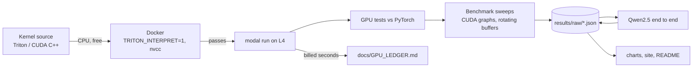

# llm-decode-kernels

Triton and CUDA kernels for the slow parts of LLM decoding: fused RMSNorm, fused SwiGLU, and a
4-bit weight matmul. Each one is tested against PyTorch, measured against the GPU's limits, and
swapped into Qwen2.5-1.5B.

<!-- gen:headline -->
_Headline pending: results not in yet._
<!-- /gen:headline -->


## Results


### End to end, Qwen2.5-1.5B-Instruct

<!-- gen:e2e -->
| GPU | Backend | Decode tok/s (batch 1) | Swapped layers, ms/token | Prefill tok/s (T=2048) | WikiText-2 ppl | Linear weights |
|---|---|---|---|---|---|---|
<!-- /gen:e2e -->

### 4-bit matmul (W4A16)

<!-- gen:w4a16 -->
| Layer (N x K) | M | GPU | Triton (us) | CUDA (us) | fp16 cuBLAS (us) | torchao (us) | torch.compile (us) | Triton vs fp16 | Triton % peak BW |
|---|---|---|---|---|---|---|---|---|---|
<!-- /gen:w4a16 -->

### Fused RMSNorm and SwiGLU

<!-- gen:kernels -->
| Kernel | Shape | GPU | Ours (us) | PyTorch eager (us) | torch.compile (us) | Speedup vs eager | % peak BW |
|---|---|---|---|---|---|---|---|
<!-- /gen:kernels -->

Times are CUDA-graph medians of 3 sweeps, with enough rotating input copies that every call reads
from DRAM (working set at least 4x the L2 cache).
<!-- gen:spread -->

<!-- /gen:spread -->

### Cost

<!-- gen:cost -->
Total GPU time: **0.01 GPU-hours**, estimated **$0.01** (cap $30), of which H100: 0 min. Every run is in [docs/GPU_LEDGER.md](docs/GPU_LEDGER.md).
<!-- /gen:cost -->

## Quickstart

```bash
pip install -e ".[local]" && python -m modal setup   # once
docker compose run --rm cpu                          # all kernel tests on CPU, free
python -m kernels.gpu pytest                         # same tests on an L4 (about $0.05)
```

Rebuild every chart, the site and this README's tables from the saved results (no GPU):
`python -m kernels.assets`.

## How it works



- **Fused RMSNorm + residual** ([kernels/rmsnorm.py](kernels/rmsnorm.py)): one program per row,
  adds the residual, writes the new residual stream and the normalized output in one pass.
- **Fused SwiGLU** ([kernels/swiglu.py](kernels/swiglu.py)): reads both halves of the merged
  gate/up output in place and writes `silu(gate) * up`.
- **W4A16 matmul** ([kernels/w4a16.py](kernels/w4a16.py)): int4 weights packed 8 per int32,
  fp16 scale and zero per group of 128, unpacked and dequantized in registers, then `tl.dot` on
  tensor cores. Autotuned. Decode shapes (batch 1 to 16) can split K across programs so a small
  matmul still fills the GPU.
- **CUDA C++ decode kernel** ([kernels/cuda/w4a16_decode.cu](kernels/cuda/w4a16_decode.cu)): the
  same math as a hand-written GEMV with 16-byte loads, shared-memory reduction and split-K.
- **End to end** ([kernels/e2e/model.py](kernels/e2e/model.py)): a small Qwen2 runner on the
  Hugging Face weights with a static KV cache, captured in a CUDA graph. fp16 and 4-bit use the
  same runner, so the difference is the kernels.

Benchmark method and every judgment call: [docs/DECISIONS.md](docs/DECISIONS.md).

## Limitations

- Quantization is plain round-to-nearest. AWQ or GPTQ would lose less quality; that was out of
  scope. The perplexity change belongs to the quantization method, not the kernels.
- Embeddings, `lm_head`, attention and RoPE stay fp16. On a 1.5B model the fp16 `lm_head` is a
  large share of the bytes read per token, which caps the end-to-end speedup.
- Batch 1 decode only for the end-to-end numbers. The CUDA kernel covers decode (M up to 16) only.
- Cloud GPUs vary from run to run. We report the median of 3 sweeps in one container per GPU,
  not across many machines.
- The torchao baseline runs in bf16 because its int4 kernel (tinygemm) only supports bf16.
- Two GPU types (L4, H100). No AMD, Apple, or multi-GPU.
